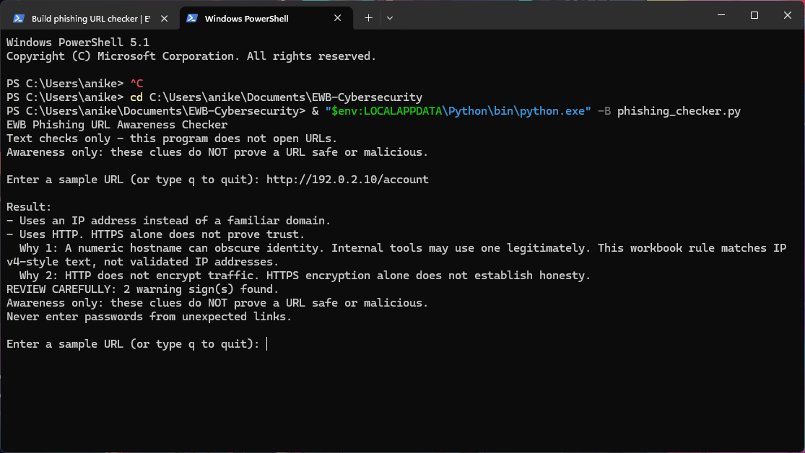
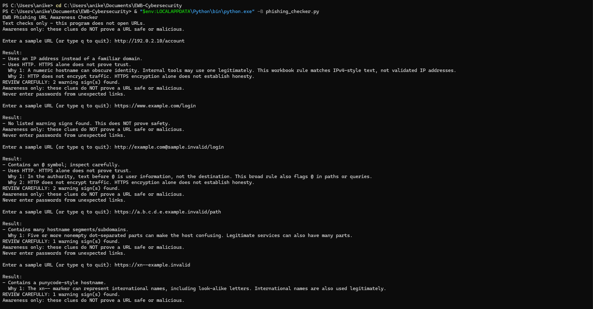

# EWB Phishing URL Awareness Checker

Phishing uses deceptive messages or links to trick people into sharing sensitive
information. This educational Python application reads URL strings and reports
six visible warning signs. It never connects to the destination.

## Requirements and installation

Python 3.10 or later. Only the standard library is used; no installation of
packages, API keys or network access is needed. `requirements.txt` documents this.

Open PowerShell in this project folder:

```powershell
cd C:\Users\anike\Documents\EWB-Cybersecurity
python -B phishing_checker.py
```

On this PC, the WindowsApps `python` alias failed during development. The working
interpreter can be invoked directly:

```powershell
& "$env:LOCALAPPDATA\Python\bin\python.exe" -B phishing_checker.py
```

On macOS/Linux use `python3 -B phishing_checker.py`. Enter a workbook sample at
the prompt. Enter `q`, `quit` or `exit` to leave. Ctrl+C or end-of-input also exits
cleanly. Importing `phishing_checker` does not start the prompt.

## Features and rules

Outer whitespace is stripped. Empty input produces `No URL entered.`. If `://`
is absent, `http://` is added for parsing and the CLI explains that assumption.
The six checks run in workbook order and preserve the workbook's warning wording:

| Rule | Trigger | Why it matters and its limit |
|---|---|---|
| @ symbol | `@` anywhere in candidate text | User information before @ in an authority can mislead readers about the host. This broad rule also flags @ in paths/queries. |
| Long URL | More than 100 characters after trimming | Long text can hide important details. Legitimate links can be long too. |
| IPv4-style hostname | Full hostname matches `(?:\d{1,3}\.){3}\d{1,3}` | Numeric-looking hosts can obscure identity. This starter regex does not validate octet ranges and does not detect IPv6. |
| Many hostname segments | At least five nonempty dot-separated parts | Stacked names can confuse readers; legitimate services may also have many parts. This counts parts, not registered-domain boundaries. |
| Punycode-style hostname | Lowercase hostname contains `xn--` | Encoded international names may contain look-alike characters; many international names are legitimate. This is a substring heuristic, not IDNA validation. |
| HTTP | Parsed scheme is `http`, case insensitive | HTTP lacks transport encryption. HTTPS alone does not establish trust. Missing schemes also trigger this rule. |

All detected signs are printed. With none, the exact response is
`No listed warning signs found. This does NOT prove safety.`
See `WORKBOOK_REQUIREMENTS.md` for extracted requirements, five samples, testing
expectations, the 100-mark rubric and submission requirements.

## Improvements

1. **Repeat and quit loop (workbook option A):** check multiple strings in one
   session. Quit aliases, EOF and Ctrl+C exit cleanly. Mocked CLI tests verify
   repeated results and all exit paths.
2. **Malformed-input handling (option C):** parser/hostname `ValueError` produces
   a clear format message instead of a traceback. Tests cover malformed IPv6
   brackets, Unicode authority errors, missing hosts and empty input.
3. **Explanations and review summary (options B/D/E):** each warning has a simple
   explanation and the CLI counts real warnings separately from input notices.
   Tests verify explanations, counts and the absence of counts for input errors.

All five workbook examples were rerun after these improvements and passed.

## Example output

Excerpt from a real local CLI execution using `http://192.0.2.10/account`:

```text
Result:
- Uses an IP address instead of a familiar domain.
- Uses HTTP. HTTPS alone does not prove trust.
  Why 1: A numeric hostname can obscure identity. Internal tools may use one legitimately. This workbook rule matches IPv4-style text, not validated IP addresses.
  Why 2: HTTP does not encrypt traffic. HTTPS encryption alone does not establish honesty.
REVIEW CAREFULLY: 2 warning sign(s) found.
Awareness only: these clues do NOT prove a URL safe or malicious.
Never enter passwords from unexpected links.
```

## Testing

Run from the project root (replace `python` with the working interpreter above
if necessary):

```powershell
python -B -m unittest discover -s tests -v
python -B -m tests.run_samples
```

Refresh the actual-results table with `python -B -m tests.run_samples --write`.
The table in `tests/test_samples.md` contains the exact five workbook examples,
expected and actual messages, PASS/FAIL, interpreter, OS and execution date.
`tests/test_run.txt` contains the complete automated test output;
`tests/cli_runs.txt` records actual subprocess runs with each workbook input.
Additional synthetic strings use reserved example names/documentation IP space
to test boundaries; nothing is opened. Tests cover 100/101 characters, four/five
segments, host versus path, case, empty input, malformed parsing and CLI behavior.

## Screenshots

The genuine sample-run screenshot has been added and visually verified:



The user also supplied a readable capture of the five test scenarios:



In this capture, the last URL omits the workbook's trailing `/`; it produces the
same punycode warning. The exact five strings, including that slash, were run
automatically and are recorded in `tests/test_samples.md` and `tests/cli_runs.txt`.

To recapture either image, use the instructions below. Keep the terminal path and command
visible, zoom text so it is readable, and exclude private information.

For `screenshots/sample_run.png`:

```powershell
cd C:\Users\anike\Documents\EWB-Cybersecurity
& "$env:LOCALAPPDATA\Python\bin\python.exe" -B phishing_checker.py
```

Type `http://192.0.2.10/account`, press Enter, and leave the prompt/result visible.
Press **Win+Shift+S**, select the terminal, open the capture in Snipping Tool and
save it as `screenshots/sample_run.png`.

For `screenshots/test_results.png`, use a fresh terminal view:

```powershell
& "$env:LOCALAPPDATA\Python\bin\python.exe" -B -m tests.run_samples
```

Resize/zoom so all five inputs, results and the `5/5` summary are readable, then
capture with Win+Shift+S and save as `screenshots/test_results.png`. The workbook
also accepts the completed table opened in VS Code. The README already embeds
both images using these relative paths:

```markdown


```

## Limitations

This is an awareness checker, not proof that a URL is safe or malicious. It
performs no requests, DNS resolution, website visits, crawling or scanning.
It does not inspect content, redirects, certificates, malware, ownership or
reputation. False positives and missed phishing links are expected. A dangerous
link can trigger none of these rules. Parsing success is not URL validation:
the parser can accept unusual ports, schemes and hostname text. Encoded @ signs,
Unicode look-alikes without an `xn--` marker and alternative numeric host formats
are not detected by these six starter rules. Input error messages describe a
parsing problem, not a threat verdict. No URL history is saved by the CLI.

## Ethical use

Use workbook samples and synthetic test strings for defensive learning. Do not
send phishing messages, collect credentials, open suspicious links or probe
websites. Never include secrets or private URLs in screenshots or repositories.

## Project structure

```text
phishing_checker.py           CLI entry point and inspect_url compatibility export
url_checker/
  __init__.py
  rules.py                    Pure checks and structured results
  cli.py                      Prompts, explanations and summaries
tests/
  __init__.py
  samples.py                  Exact workbook inputs and expected messages
  test_checker.py             unittest coverage
  run_samples.py              Five-sample runner and evidence generator
  test_samples.md             Actual five-sample results
  test_run.txt                Actual unittest output
  cli_runs.txt                Actual CLI subprocess transcripts
screenshots/
  README.md                   Capture status
  sample_run.png              Verified genuine sample run
  test_results.png            User capture of five scenarios
README.md
WORKBOOK_REQUIREMENTS.md
SUBMISSION_CHECKLIST.md
requirements.txt
.gitignore
```

The supplied PDF and raw text extraction remain local reference material and
are ignored by Git. Use `-B` to avoid creating `__pycache__` directories.

## Author and AI-assistance disclosure

- **Student:** Aniket
- **Programme:** AI Powered Cyber Security Internship
- **Organisation:** EWB EDUTECH PRIVATE LIMITED
- **Role:** Cyber Security Intern
- **Cohort start date:** 28 September 2026
- **Duration:** 4 weeks

Programme, role, start date and duration were verified against the student's
offer letter. No separate batch identifier is stated in that letter.

OpenAI Codex extracted the workbook text, generated the implementation, tests
and documentation, and ran local checks. This is substantial AI assistance;
Aniket has confirmed reviewing the project. The student should be able to explain
the work and follow EWB's authorship/AI policy; policy compliance has not been independently verified.
The workbook asks for the student's own improvements and README wording; this
AI-generated draft alone does not demonstrate that requirement. The student
provided both screenshots. Publication and submission remain pending.
